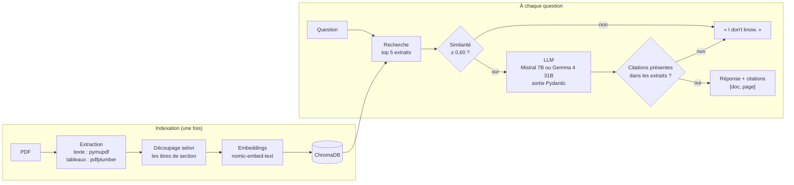
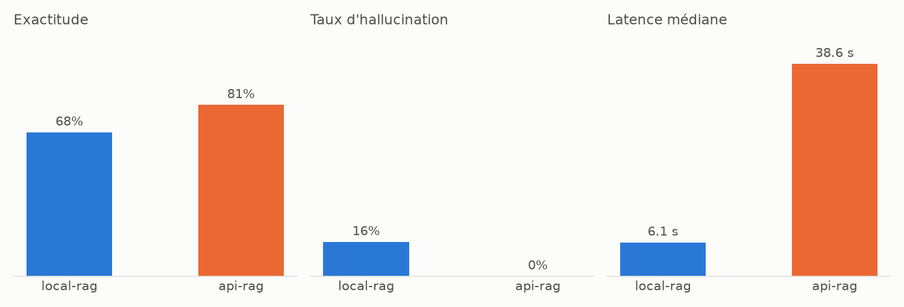

# doc-assistant

**Assistant de questions-réponses sur des PDF techniques, qui cite ses sources, sait dire « je ne sais pas », et est évalué de bout en bout.**

Il répond à des questions sur des datasheets et un document de certification aéronautique : une valeur dans un tableau, un calcul à partir de deux valeurs, l'extraction de plusieurs caractéristiques. Chaque réponse cite le document et la page d'où elle vient. Si la réponse n'est pas dans les documents, l'assistant refuse au lieu d'inventer.

La question étudiée : **un petit modèle local (Mistral 7B, sur une carte graphique grand public de 6 Go) suffit-il pour ce cas d'usage, ou faut-il un modèle plus gros dans le cloud (Gemma 4 31B) ?** Pour y répondre, les deux modèles passent le même pipeline sur un jeu de 31 questions annotées à la main.

## Résultats en bref

| | Mistral 7B local | Gemma 4 31B (API) |
|---|---|---|
| Exactitude | 68 % | **81 %** |
| Taux d'hallucination | 16 % | **0 %** |
| Latence médiane | **6,1 s** | 38,6 s |
| Coût estimé pour 1000 questions | matériel local | 0,23 $ |

- **Gemma n'invente jamais, mais refuse trop.** Elle a refusé 6 questions qui avaient une réponse.
- **Mistral répond plus souvent, mais se trompe parfois sans prévenir.** Il donne 3 valeurs fausses avec assurance.
- **Un tiers des échecs vient de la recherche, pas du LLM.** Quand la bonne page n'est pas dans les 5 extraits retrouvés, aucun des deux modèles ne peut répondre.

Le détail est plus bas : [résultats](#résultats) et [analyse des erreurs](#analyse-des-erreurs).

## Architecture



**Les choix importants :**

- **Les tableaux sont extraits à part.** Chaque tableau est converti en markdown, avec sa légende, pour que le LLM garde les lignes et les colonnes alignées.
- **Le découpage suit la structure du document.** Les titres de section servent de points de coupure, au lieu d'un découpage tous les N caractères. Chaque extrait porte en métadonnées son document, sa page, sa section et son type (texte ou tableau).
- **La sortie est structurée.** Le LLM doit renvoyer un objet Pydantic `{answer, citations[], is_answerable, confidence}`, validé par le code.
- **Il y a deux garde-fous dans le code, pas seulement dans le prompt :**
  - si même l'extrait le plus proche est sous un seuil de similarité, l'assistant refuse sans appeler le LLM ;
  - une citation vers une page qui n'est pas dans les extraits fournis est rejetée, et une réponse sans citation valide devient un refus.
- **Les deux configurations sont identiques, sauf le modèle.** Mêmes embeddings, même top 5, même prompt, température 0. Seul le LLM change.

## Corpus

| Document | Pages | Pourquoi |
|---|---|---|
| Bosch BME280 (capteur pression / humidité / température), datasheet | 60 | Beaucoup de tableaux de caractéristiques, registres, modes d'alimentation |
| Samsung INR18650-35E (cellule Li-ion), spécification | 6 | Tableaux chiffrés, questions avec calcul |
| EASA TCDS Dassault Falcon 7X (fiche de certification de type) | 22 | Document réglementaire aéronautique, variantes selon les modifications |

Au total : 229 extraits indexés (164 de texte, 65 tableaux).

Les PDF ne sont pas versionnés, car les droits appartiennent aux fabricants. Leurs URL et versions exactes sont dans [data/sources.md](data/sources.md).

## Installation

Prérequis :
- Python 3.11 et [uv](https://docs.astral.sh/uv/) ;
- [Ollama](https://ollama.com/) ;
- une clé gratuite [Google AI Studio](https://aistudio.google.com/), pour la configuration API seulement.

```bash
git clone <url-du-depot>
cd doc-assistant
uv venv
uv pip install -r requirements.txt

ollama pull mistral
ollama pull nomic-embed-text

cp .env.example .env   # puis renseigner GOOGLE_API_KEY
```

Téléchargez ensuite les 3 PDF depuis [data/sources.md](data/sources.md) dans `data/pdfs/`, sous les noms suivants :
- `bme280_datasheet.pdf`
- `samsung_inr18650-35e.pdf`
- `easa_tcds_falcon7x.pdf`

## Utilisation

```bash
uv run python -m src.cli ingest                       # extrait, découpe et indexe les PDF
uv run python -m src.cli ask "What is the supply voltage range of the BME280?" --config local-rag
uv run python -m src.cli ask "..." --config api-rag   # même question avec Gemma
```

Exemple de sortie :

```
The supply voltage range of the BME280 is 1.71 V to 3.6 V.
  [source: bme280, page 2]
(refusal: None | confidence: 1.00 | latency: 4.8 s | tokens: 1716 in / 70 out)
```

Le premier appel après le démarrage d'Ollama est plus lent (environ 50 s), le temps de charger le modèle en mémoire vidéo.

Commandes de mise au point et d'évaluation :

| Commande | Rôle |
|---|---|
| `inspect --doc bme280 --type table` | Afficher des extraits indexés et leurs métadonnées |
| `search "question"` | Afficher les extraits les plus proches d'une question, avec leur similarité |
| `check-eval` | Vérifier la cohérence du jeu d'évaluation (pages existantes, champs cohérents) |
| `benchmark [--config local-rag]` | Passer le jeu d'évaluation et écrire les réponses brutes dans `results/benchmark.csv` |
| `report` | Calculer les métriques depuis le CSV et écrire `results/report.md` + `results/benchmark.png` |

## Évaluation

### Le jeu de questions

31 questions écrites et vérifiées à la main dans les PDF ([evaluation/dataset.jsonl](evaluation/dataset.jsonl)) :

| Type | Nombre | Exemple |
|---|---|---|
| Factuelle | 12 | *Which engines power the Falcon 7X?* |
| Lecture de tableau | 6 | *What is the relative capacity of the 35E at a 2C discharge?* |
| Calcul | 5 | *How much does the pressure reading change for a 10 °C temperature change?* |
| Extraction multi-champs | 3 | *Extract the charging voltage, nominal voltage, cut-off voltage and charging current.* |
| Sans réponse dans les documents | 5 | *What is the maximum range of the Falcon 7X?* |

Les questions sans réponse sont volontairement **plausibles** : la portée du Falcon 7X ou le MTBF du BME280 pourraient être dans ces documents, mais n'y sont pas. Pendant l'annotation, un piège prévu (« Falcon 8X ») s'est révélé avoir une réponse : la note 3 page 19 indique que la modification M1000 porte la désignation commerciale « F8X ». La question a été retirée. Cela montre l'intérêt de vérifier chaque question dans le document.

Chaque question indique :
- les **faits clés** qu'une bonne réponse doit contenir, par exemple `["0.65"]` pour un calcul de marge ;
- les **pages sources**, c'est-à-dire toutes les pages qui contiennent au moins une partie de la réponse.

### La notation

La notation est **déterministe**, sans LLM-juge, donc reproductible et gratuite :

- **Faits clés :**
  - le texte est normalisé : minuscules, séparateurs de milliers, µ grec et µ micro ;
  - les nombres sont comparés avec une tolérance de 1 %, donc « 12.1 Wh » valide 12,06 Wh ;
  - un fait peut avoir des variantes : `15544|51000` accepte les mètres ou les pieds.
- **Exactitude :**
  - une question avec réponse est réussie si elle obtient une réponse contenant tous les faits clés ;
  - une question sans réponse est réussie si elle obtient un refus.
- **Hallucination :** le système a répondu au lieu de refuser, et la réponse n'est pas juste.
- **Refus :** on calcule une précision, un rappel et un F1, en traitant « refuser » comme une classification.
- **Citations :**
  - la précision est la part des pages citées qui sont de bonnes pages ;
  - on compte aussi la part des réponses qui citent au moins une bonne page.
- **Latence :** médiane et 95ᵉ centile.
- **Coût :** tokens comptés, puis convertis au tarif payant public.

La **collecte** et la **notation** sont séparées :
- `benchmark` enregistre les réponses brutes au fil de l'eau. Il reprend là où il s'est arrêté s'il est interrompu, et réessaie quand l'API gratuite est saturée.
- `report` recalcule toutes les métriques en une seconde, sans rappeler les modèles.

Chaque ligne garde aussi la réponse **avant** le garde-fou de citations, ce qui permet de mesurer ce qu'il coûte.

## Résultats

| Métrique | local-rag (Mistral 7B) | api-rag (Gemma 4 31B) |
|---|---|---|
| Exactitude | 68 % | 81 % |
| Exactitude sans le garde-fou de citations | 74 % | 81 % |
| Taux d'hallucination | 16 % | 0 % |
| Précision des refus | 0.50 | 0.45 |
| Rappel des refus | 1.00 | 1.00 |
| F1 des refus | 0.67 | 0.62 |
| Précision des citations | 0.74 | 1.00 |
| Réponses citant au moins une bonne page | 86 % | 100 % |
| Extraction : part des champs trouvés | 83 % | 67 % |
| Latence médiane | 6.1 s | 38.6 s |
| Latence p95 | 15.2 s | 116.2 s |
| Tokens en entrée (total) | 48,401 | 44,400 |
| Tokens en sortie (total) | 2,825 | 2,320 |
| Coût estimé pour 1000 questions | — | 0.23 $ |



Le tableau est généré par `report` ([results/report.md](results/report.md)), à partir des réponses brutes ([results/benchmark.csv](results/benchmark.csv)).

**Conditions :**
- **Local :** Mistral 7B quantifié (Q4) via Ollama, sur un i7-8750H et une RTX 2060 6 Go. Le contexte est limité à 4096 tokens pour tenir en mémoire vidéo (88 % GPU / 12 % CPU).
- **API :** Gemma 4 31B via Google AI Studio, en offre gratuite, avec le raisonnement réglé au minimum (`thinking_level="minimal"`) pour une comparaison équitable avec Mistral, qui ne raisonne pas. La latence mesurée est celle de l'offre gratuite, souvent chargée : quelques erreurs 503 « high demand », absorbées par les nouvelles tentatives du benchmark.
- **Coût :** au tarif payant public de 0,14 $ / 0,40 $ par million de tokens en entrée / sortie (vérifié le 2026-11-10).

## Analyse des erreurs

**Les deux modèles ne se trompent pas de la même façon :**

| | Mistral 7B (10 échecs) | Gemma 4 31B (6 échecs) |
|---|---|---|
| Bonne page jamais retrouvée par la recherche | 2 (f10, t04) | 2 (f10, t04) |
| Réponse partielle : une partie des pages manquait | 1 (e02) | 1 (e02) |
| Refus alors que la réponse était dans le contexte | 2 (c01, c02) | 3 (t02, c01, c02) |
| Valeur fausse donnée avec assurance | 3 (t02, c03, c04) | 0 |
| Bonne réponse rejetée par le garde-fou de citations | 2 (f04, f11) | 0 |

### Exemple 1 : la même question, deux comportements

*« How much does the pressure reading of the BME280 change for a 10 °C temperature change at constant pressure? »*
Réponse attendue : ±15 Pa, soit 10 × ±1,5 Pa/K.

- **Gemma :** ±15 Pa, avec le calcul détaillé (10 × ±1,5 Pa/K) et la citation de la page 2. Elle a trouvé le bon coefficient et fait le calcul.
- **Mistral :** « ±12.6 cm ». La datasheet écrit sur la même ligne « ±1.5 Pa/K, equiv. to ±12.6 cm at 1 °C temperature change ». Mistral a recopié l'équivalent en altitude pour 1 °C, sans multiplier par 10, et répond en centimètres à une question sur une pression. Il n'a donné aucun signal de doute.

### Exemple 2 : un refus réussi

*« What is the maximum range of the Falcon 7X in nautical miles? »*

La fiche de certification contient des masses, l'altitude maximale et les capacités de carburant, mais pas la portée. C'est une donnée commerciale. Les deux modèles répondent « I don't know. », sans citation. Les 5 questions pièges ont toutes été refusées par les deux configurations (rappel des refus de 1,0).

### Exemple 3 : quand le garde-fou rejette une bonne réponse

*« Which engines power the Falcon 7X? »*

Mistral répond correctement (« three Pratt & Whitney Canada PW307A (PW307D in case of modification M1000 installed) »), mais cite la **page 2**. C'est une page blanche, absente des extraits fournis. Le garde-fou rejette donc la citation et transforme la réponse en refus.

C'est le prix du garde-fou : **2 bonnes réponses perdues sur 31 pour Mistral, 0 pour Gemma**. En échange, aucune réponse ne peut s'appuyer sur une source inexistante. Pour un usage où une mauvaise source est grave (certification, maintenance), le compromis vaut le coup.

### Ce qu'on en retient

- **Gemma est plus fiable, mais trop prudente.** Elle a refusé 3 questions dont la réponse était dans le contexte : une lecture de tableau et deux calculs. Pourtant, le prompt autorise explicitement les calculs simples.
- **Mistral est rapide et souvent juste.** Mais ses erreurs ne se voient pas : une valeur fausse a la même forme qu'une valeur juste. Le champ `confidence` n'aide pas, car le modèle l'auto-déclare et ce n'est pas fiable (une confiance de 1.00 a été observée sur un refus).
- **La recherche est le goulot commun.** f10 (altitude maximale, page 14) et t04 (courant de mesure, tableau page 8) sont ratées par les deux modèles, parce que la page n'est pas dans le top 5. Un meilleur LLM n'y change rien. Sur le jeu complet, la bonne page est retrouvée pour 24 questions sur 26.
- **Réponse à la question de départ :**
  - pour une aide à la consultation rapide, où un humain vérifie la page citée, **Mistral 7B en local suffit** : 6 s, aucune donnée envoyée à l'extérieur ;
  - pour des réponses utilisées sans relecture, **son taux d'hallucination (16 %) est rédhibitoire**, et le modèle cloud est préférable malgré sa latence.

## Limites

- **31 questions, c'est peu.** Un écart d'une question vaut 3 points d'exactitude. Les tendances sont nettes, mais les pourcentages ne sont pas précis à 1 point près.
- **La notation par faits clés a des angles morts :**
  - un nombre peut être retrouvé par hasard dans une réponse qui en cite beaucoup ;
  - « 1 700 » écrit avec une espace n'est pas reconnu comme 1700 ;
  - une réponse partielle qui dit « non précisé » est comptée comme une hallucination (t04 et e02 pour Mistral). Sur les 5 hallucinations de Mistral, 3 sont de vraies valeurs inventées.
- **Les deux modèles ne sont pas de la même famille** (Mistral contre Gemma). La comparaison mesure « petit modèle local contre gros modèle cloud », pas l'effet de la taille seule.
- **La recherche est faible sur les tableaux.** Un tableau converti en markdown a un embedding peu proche d'une question en langage naturel. Une recherche hybride avec BM25 a été testée, avec un gain mitigé.
- **La latence de l'API** est celle de l'offre gratuite. Elle ne représente pas l'offre payante.

## Pistes d'amélioration

- **Recherche :**
  - reranker (cross-encoder) sur un top 20 ;
  - recherche hybride BM25 + embeddings, mieux réglée ;
  - embedding des tableaux à partir de leur légende et de leurs en-têtes.
- **Agent LangGraph :**
  - un outil de calcul exécuté en Python, au lieu du LLM ;
  - une extraction structurée champ par champ ;
  - plusieurs recherches successives. Cela vise directement les échecs de calcul et de recherche ci-dessus.
- **Citations :** corriger automatiquement une citation vers la page de l'extrait qui contient la valeur, au lieu de rejeter la réponse.
- **Modèle local :** essayer un modèle plus récent de taille équivalente, ou affiner (fine-tuning) le modèle sur ce format de réponse.

## Structure du dépôt

```
doc-assistant/
├── data/sources.md        # URL et versions des PDF (les PDF eux-mêmes ne sont pas versionnés)
├── src/
│   ├── ingest.py          # extraction texte + tableaux, découpage, indexation ChromaDB
│   ├── retriever.py       # recherche par similarité
│   ├── llm.py             # interface commune Ollama / Google : texte, latence, tokens
│   ├── schemas.py         # modèles Pydantic : Answer, Citation
│   ├── rag.py             # prompt, garde-fous, pipeline
│   └── cli.py             # commandes typer
├── evaluation/
│   ├── dataset.jsonl      # 31 questions annotées
│   ├── dataset.py         # chargement et vérification du jeu
│   ├── metrics.py         # faits clés, exactitude, refus, citations, latence
│   ├── run_benchmark.py   # collecte des réponses (reprise, nouvelles tentatives)
│   └── report.py          # tableau markdown + graphique
└── results/               # benchmark.csv, report.md, benchmark.png
```

## Stack

Python 3.11 · Ollama (Mistral 7B, nomic-embed-text) · Google AI Studio (Gemma 4 31B) · LangChain · ChromaDB · Pydantic · pymupdf · pdfplumber · typer · matplotlib
