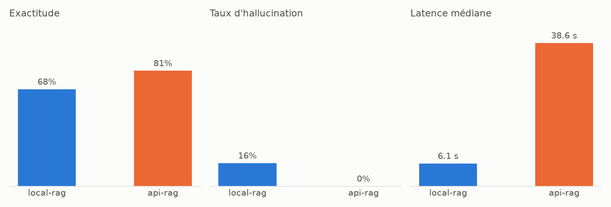

# Résultats du benchmark

31 questions, température 0, mêmes embeddings et même top-k pour toutes les configurations.

| Métrique | local-rag | api-rag |
|---|---|---|
| Exactitude | 68% | 81% |
| Exactitude sans le garde-fou de citations | 74% | 81% |
| Taux d'hallucination | 16% | 0% |
| Précision des refus | 0.50 | 0.45 |
| Rappel des refus | 1.00 | 1.00 |
| F1 des refus | 0.67 | 0.62 |
| Précision des citations | 0.74 | 1.00 |
| Réponses citant au moins une bonne page | 86% | 100% |
| Extraction : part des champs trouvés | 83% | 67% |
| Latence médiane | 6.1 s | 38.6 s |
| Latence p95 | 15.2 s | 116.2 s |
| Tokens en entrée (total) | 48,401 | 44,400 |
| Tokens en sortie (total) | 2,825 | 2,320 |
| Coût estimé pour 1000 questions | — | 0.23 $ |

Coût : tarif payant public de Gemma 4 31B (0.14 $ / 0.4 $ par million de tokens en entrée / sortie) ; le local tourne sur une RTX 2060 6 Go, sans coût par token.

## Questions ratées

- **local-rag** : f04, f10, f11, t02, t04, c01, c02, c03, c04, e02 (sans le garde-fou : f10, t02, t04, c01, c02, c03, c04, e02)
- **api-rag** : f10, t02, t04, c01, c02, e02 (sans le garde-fou : f10, t02, t04, c01, c02, e02)

